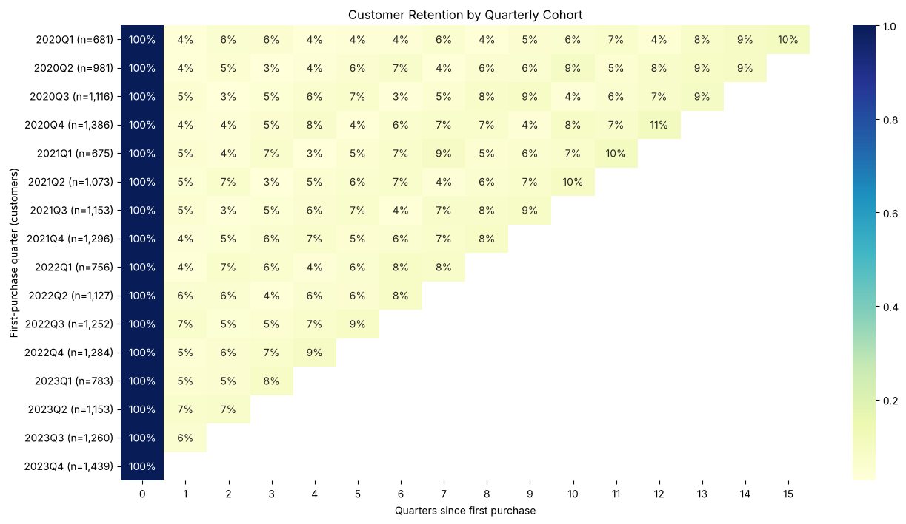
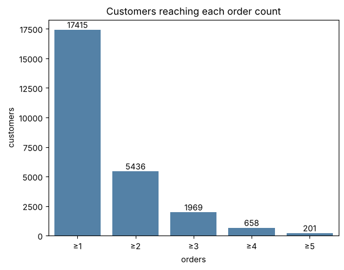
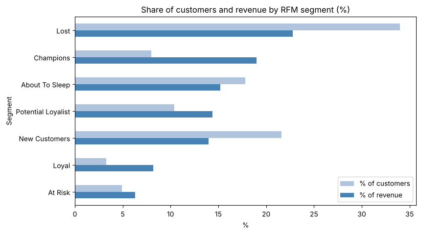

# Customer Retention & Repeat Purchase Analysis – E-commerce Beauty Store

An online beauty store gets plenty of first-time buyers, but most never come back. This project measures how many customers return and when, finds where they drop off on the way to a repeat purchase, groups customers by buying behaviour, and designs an A/B test to check whether a second-order voucher would pay off.

**Tools:** Python (pandas, NumPy, Matplotlib, seaborn, statsmodels) · Jupyter Notebook

**Methods:** cohort retention · repeat-purchase funnel · RFM segmentation · A/B test design (break-even MDE, sample size, test duration)

**Project report (PDF):** [Customer_Retention_Analysis_Report.pdf](Customer_Retention_Analysis_Report.pdf), a short summary of the data, approach, findings and recommendations.

> The analysis is available in two languages: `Customer_Retention_Repeat_Purchase_Analysis_English.ipynb` and `Customer_Retention_Repeat_Purchase_Analysis_Vietnamese.ipynb` (same code and results).

## Key findings

**1. Most customers buy only once.** 69% of 17,415 customers (11,979) placed a single order, and only 31% placed a second one. In most quarterly cohorts, only about 4–7% of new customers buy again in the following quarter.

**2. The biggest loss is between the 1st and 2nd order.** Nearly 12,000 customers stop after their first order. After that, each step keeps roughly one third of customers (31–36%): 5,436 customers reach a 2nd order, 1,969 a 3rd, 658 a 4th and 201 a 5th.

**3. Customers come back slowly.** Among 12,780 customers with at least 12 months of history, only 4.6% placed a 2nd order within 90 days, 9.0% within 180 days and 17.8% within a year. The median time to the 2nd order is 402 days, so more than half of returning customers come back after more than a year.

**4. Revenue is concentrated in a small group.** Using RFM, Champions are 8.0% of customers but bring in 19.0% of revenue; together with Loyal customers they are 11.3% of customers and 27.2% of revenue. New Customers and Potential Loyalists (about 32% of customers) bought recently and are the best candidates for a next order.

**5. Repeat buyers are more profitable and get smaller discounts.** Average profit per order rises from about 38.8 (1 order) to 56.8 (5+ orders), profit margin from 15.6% (1 order) to about 19% (4+ orders), while the average discount falls from 15% to 12%. This is an association, not proof that discounts do not drive repeat purchases.

**6. Segment and income do not separate repeat buyers from one-time buyers.** Corporate and Consumer customers return at similar rates, and average annual income is almost the same in every order-count group (55,000–58,000).

**7. Body care drives volume for every customer group.** It accounts for 51.3% of units sold, with almost the same share among one-time buyers. Face care has the highest share of customers with 3+ orders (about 24% vs 15% for Body care), but this gap mostly reflects how many customers each category reaches.

## A/B test design: second-order voucher

There is no experiment in the data, so section VII designs one rather than running it. The minimum detectable effect (MDE) is set at the **break-even** lift: the smallest increase in the 90-day repurchase rate that makes the voucher profitable, since a smaller lift would not justify a rollout even if it were detected.

Inputs: baseline 90-day repurchase rate 4.6%, average profit per order 41.4 USD, about 1,088 new customers per quarter, alpha = 0.05, power = 0.8.

| Voucher | Break-even rate | MDE | Relative lift | Customers per group | Duration (incl. 90-day follow-up) |
|---|---|---|---|---|---|
| 5 USD | 5.3% | +0.6 pp | +13.7% | 18,187 | ~34 quarters |
| 10 USD | 6.1% | +1.5 pp | +31.9% | 3,641 | ~7.7 quarters |
| 15 USD | 7.3% | +2.6 pp | +56.8% | 1,250 | ~3.3 quarters |

A small voucher is easy to break even on but takes years to measure; a large voucher is quick to measure but needs a much bigger lift to be profitable. With the current number of new customers, only the 15 USD option gives a result within a year.

## Recommendations

- **Focus on moving customers from the 1st to the 2nd order** with repurchase reminders or a voucher, since this is where most customers are lost.
- **Test before rolling out.** Start with the 15 USD voucher (about 10 months) and roll out only if the treatment group beats both the control group (p < 0.05) and the 7.3% break-even rate.
- **Target offers by buying behaviour (RFM), not by income or segment:** retain Champions, push New Customers and Potential Loyalists to their next order, and use only low-cost campaigns for Lost customers.
- **Try Face care as an introductory product for new customers** and measure the 2nd-order rate. This is a hypothesis to test.

## Analysis questions

1. When do new customers arrive, and do they come back? (quarterly cohort retention)
2. Do Corporate and Consumer customers differ in how often they return?
3. How many customers move from the 1st to the 2nd, 3rd, 4th order, and how long does the 2nd order take? (repeat-purchase funnel)
4. Which customer groups exist, and which ones drive revenue? (RFM)
5. How do repeat buyers differ from one-time buyers? (income, profit per order, product categories)
6. What should the store do, and how can it be tested? (recommendations and A/B test design)

## Workflow

1. **Data preparation and cleaning:** checked missing values, duplicates and outliers in all 4 tables; standardised join keys with inconsistent formats; converted dates; joined the tables.
2. **Order and customer tables:** aggregated sales lines into one row per order (`orders`) and one row per customer (`cust`), with order sequence, first/last order date and total spend.
3. **Overview:** distribution of customers by number of orders.
4. **Cohort analysis:** retention by quarter of first purchase, overall and by segment (Corporate vs Consumer).
5. **Repeat-purchase funnel:** customers reaching each order step, time to the 2nd order (only customers with 12+ months of history, to avoid right-censoring), and comparison by segment.
6. **RFM segmentation:** R, F and M scores, with segments defined by Recency and Frequency (Monetary is used to describe each segment).
7. **Repeat-buyer profile:** profit per order, discount and margin, income, and product categories by number of orders.
8. **A/B test design:** hypothesis, metrics, break-even MDE for three voucher levels, sample size and test duration.
9. **Conclusions, recommendations and data limitations.**

## Data

A sample e-commerce dataset of a beauty store, covering 01/01/2020 – 31/12/2023: 51,290 sales lines, 25,739 orders and 17,415 customers.

| Table | Used for |
|---|---|
| `EcomSales.csv` | One row per product in an order: dates, sales, discount, profit, segment, category, quantity |
| `Customer.csv` | Customer attributes, including annual income |
| `Product.csv` | Product details |
| `Region.csv` | Region details |

## Limitations

- The data ends in Q4 2023, so later cohorts have fewer quarters of history, and customers who first bought near the end have not had time to return.
- The data shows associations, not causes; the A/B test is a design only, with no experiment results.
- There is no information on channels, marketing spend or promotions, so explanations of seasonal patterns are hypotheses.
- The 5+ order group is small (201 customers), so conclusions about it should be treated with caution.

## Files

| File | Description |
|---|---|
| `Customer_Retention_Repeat_Purchase_Analysis_English.ipynb` | Full analysis notebook (English) |
| `Customer_Retention_Repeat_Purchase_Analysis_Vietnamese.ipynb` | Full analysis notebook (Vietnamese) |
| `EcomSales.csv`, `Customer.csv`, `Product.csv`, `Region.csv` | The 4 data files used in the analysis |
| `images/` | Charts used in this README |
